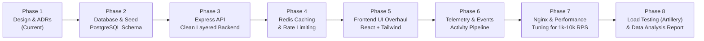

# Swirl: System Architecture & Decision Records (ADR)

> **Document Version:** 1.0.0  
> **Status:** Draft / Active Planning  
> **Target Scale:** 1,000 – 10,000 requests/second  
> **Core Stack:** React (Vite), Node.js (Express), PostgreSQL, Redis, Reverse Proxy (Nginx)

---

## 1. Executive Summary & Purpose

**Swirl** is transitioning from a client-heavy prototype that proxied external third-party APIs into a production-grade, self-contained food ordering and delivery web platform.

This document serves as the **Single Source of Truth (SSOT)** for all architectural choices, system design trade-offs, concurrency strategies, edge-case management, and learning milestones. In professional engineering organizations, documenting decisions via **Architecture Decision Records (ADRs)** prevents tribal knowledge loss, justifies technical debt, and clarifies why alternative technologies were rejected.

---

## 2. High-Level System Architecture

```mermaid
flowchart TD
    Client["Client (Browser / Mobile Web)"] -->|HTTPS / HTTP/2| RP["Reverse Proxy (Nginx / Caddy)<br/>SSL Termination, Static Assets, Gzip/Brotli, Rate Limiting"]
    
    subgraph AppServer["Application Tier (Node.js Cluster / Process Pool)"]
        RP -->|Keep-Alive HTTP / Reverse Proxy| Instance1["Node.js Worker 1 (Express)"]
        RP -->|Load Balancing Round-Robin| Instance2["Node.js Worker 2 (Express)"]
        RP -->|Load Balancing Round-Robin| InstanceN["Node.js Worker N (Express)"]
    end

    subgraph DataTier["Data & Caching Tier"]
        Instance1 & Instance2 & InstanceN -->|Cache-Aside / Sessions / Rate Limits| Redis[("Redis Caching & In-Memory Store")]
        Instance1 & Instance2 & InstanceN -->|Connection Pool (pg-pool)| Postgres[("PostgreSQL Database (ACID / Relational)")]
    end

    subgraph AnalyticsTier["Telemetry & Analytics Pipeline"]
        Instance1 & Instance2 & InstanceN -->|Async Event Logging| TelemetryStream["Event Collector / Activity Logger"]
        TelemetryStream -->|Batch Inserts / JSONL| AnalyticsStore[("Analytics Store / Postgres Audit")]
        AnalyticsStore --> AnalysisScript["Data Analysis & Behavioral Insights Engine"]
    end
```

---

## 3. High-Concurrency Reality Check: Achieving 1,000 to 10,000 req/sec

Scaling a Node.js/Express application to 1,000–10,000 requests per second (RPS) requires a deep understanding of bottlenecks across the OS, runtime, caching, and database layers.

### 3.1 The Node.js Event Loop Reality
- **Single-Threaded Loop:** Node.js executes JavaScript on a single thread. If an endpoint does synchronous JSON parsing of massive payloads or blocking operations, RPS drops to double digits.
- **Concurrency Solution:** Run Node.js in **Cluster Mode** (one worker process per CPU core) or via multi-container orchestration. A 4-core machine running 4 workers distributes incoming event-loop pressure.

### 3.2 The PostgreSQL Connection Bottleneck
- **The Pitfall:** PostgreSQL allocates memory per connection (forking backend processes). Opening 1,000 direct database connections will exhaust RAM and CPU context switching, causing queries to stall or crash the DB (`too many clients already`).
- **The Solution:**
  1. **Strict Connection Pooling (`pg-pool`):** Maintain a pool of 20–50 persistent database connections per Node process.
  2. **Never hit Postgres for high-frequency reads:** 95% of read traffic (restaurant listings, menu categories, popular items) must be served directly from **Redis**. Only cache misses or write operations touch Postgres.

### 3.3 The Reverse Proxy Advantage
- Node.js should never serve raw static assets (`.js`, `.css`, images) or handle SSL handshakes directly at 10k RPS.
- **Nginx** handles TLS termination, HTTP/2 multiplexing, static file caching, gzip/brotli compression, and buffer protection (slowloris mitigation) in C, leaving Node.js workers dedicated purely to JSON API compute.

---

## 4. Architecture Decision Records (ADRs)

### ADR-001: Frontend Architecture — React (Vite) + Tailwind CSS (Kept & Upgraded)
- **Status:** Accepted
- **Context:** Swirl currently uses React 19 with Vite, Redux Toolkit, and Tailwind CSS. We evaluated whether to migrate to Next.js (SSR/RSC) or remain on a Single Page Application (SPA).
- **Decision:** Keep React 19 + Vite SPA, but refine UI/UX, bundle size, component structure, and state management.
- **Why this over alternatives:**
  - *Alternative: Next.js (App Router)* — Introduces server-side rendering complexity and server lifecycle coupling. Because our goal is to master building dedicated REST/JSON APIs in Node.js, Express, Redis, and Postgres, separating frontend from backend gives cleaner architectural boundaries.
  - *Vite Advantages:* Near-instant HMR, pure ESM build pipeline, tiny build output, and trivial static hosting behind Nginx.
- **Consequences:** SEO for restaurant pages is client-side unless pre-rendered; initial bundle must be optimized with code-splitting (`React.lazy`).

---

### ADR-002: Backend Runtime & Framework — Node.js + Express
- **Status:** Accepted
- **Context:** Need an API backend capable of high throughput, simple routing, clean middleware architecture, and seamless integration with Redis and PostgreSQL.
- **Decision:** Use Node.js with **Express**, structured with a strict layered architecture:
  - `Routes` -> `Controllers` -> `Services` -> `Repositories/Models` -> `Database`.
- **Why this over alternatives:**
  - *Alternative: Fastify* — Fastify is ~2x faster out of the box in micro-benchmarks due to fast JSON stringification and Radix-tree routing. However, Express is the industry standard for learning middleware patterns, error handling pipelines, and request-response lifecycles. With proper clustering and Redis caching, Express easily handles 1k–5k+ RPS.
  - *Alternative: Go / Rust* — While Go/Rust achieve 50k+ RPS with tiny memory footprints, Node.js allows end-to-end JavaScript/TypeScript fluency and faster iteration for this project.
- **Consequences:** We must avoid CPU-intensive synchronous operations in routes to prevent blocking the event loop.

---

### ADR-003: Primary Database — PostgreSQL (Relational)
- **Status:** Accepted
- **Context:** Need to store users, restaurant metadata, menus, items, categories, orders, and order line items with high consistency and relational integrity.
- **Decision:** Use **PostgreSQL**.
- **Why this over alternatives:**
  - *Alternative: MongoDB (Document DB)* — While MongoDB offers schema flexibility, e-commerce and food ordering platforms are inherently relational (Users have Orders, Orders have OrderItems linked to MenuItems, Restaurants own Menus). MongoDB requires manual application-level joins or duplicate data that leads to consistency nightmares during menu price updates.
  - *PostgreSQL Advantages:* Full ACID compliance, robust foreign key constraints, transactional isolation (crucial for orders), powerful indexing (B-Tree, GIN), and native JSONB support if we ever need schema-less extensions for restaurant tags or dietary metadata.
- **Consequences:** Requires explicit schema migrations and connection pool tuning.

---

### ADR-004: In-Memory Caching & State Store — Redis
- **Status:** Accepted
- **Context:** Database queries for popular restaurants and menus will saturate PostgreSQL under high load. We also require atomic operations for rate limiting and session management.
- **Decision:** Deploy **Redis** as a distributed cache-aside and in-memory key-value engine.
- **Key Use Cases:**
  1. **Menu & Restaurant Cache:** Key format `res:menu:{id}` with TTL (e.g., 5–15 minutes) and selective invalidation on menu update.
  2. **Rate Limiting:** Token Bucket or Sliding Window Log per IP to safeguard endpoints from abuse.
  3. **User Session / Cart Cache:** Optional fast retrieval of ephemeral cart data.
- **Why this over alternatives:**
  - *Alternative: In-Memory Node Cache (e.g. `lru-cache`)* — In-memory node caches live within a single process. In a multi-worker cluster, cache states diverge (Cache Inconsistency), and memory restarts on deployment. Redis provides a centralized, blazing-fast (sub-millisecond) external cache shared across all Node instances.
- **Consequences:** Must handle cache invalidation, cache stampede, and Redis connectivity failover gracefully.

---

### ADR-005: Reverse Proxy & Gateway — Nginx
- **Status:** Accepted
- **Context:** In front of the application server, we need an entry point for SSL termination, static file serving, rate limiting, gzip/brotli compression, and reverse proxying to Node.js workers.
- **Decision:** Use **Nginx**.
- **Why this over alternatives:**
  - *Alternative: Caddy* — Caddy provides automatic HTTPS with zero config, but Nginx is the battle-tested industry benchmark used by high-traffic systems worldwide. Learning Nginx configuration syntax, upstream blocks, worker connection tuning, and caching headers is a core DevOps/systems engineering skill.
  - *Alternative: Direct Node.js exposure* — Exposing Node.js directly to the internet at scale is dangerous and slow. Node is inefficient at serving static assets compared to Nginx’s `sendfile` kernel-level streaming.
- **Consequences:** Requires Nginx configuration files and reverse proxy headers (`X-Forwarded-For`, `X-Real-IP`).

---

### ADR-006: Load Testing & Performance Benchmarking — Artillery + Autocannon
- **Status:** Accepted
- **Context:** Need to test and verify that our system can achieve 1k–10k req/sec under realistic conditions (mixed read/write workflows).
- **Decision:** Use **Artillery** for complex user scenario simulation (browse -> search -> view menu -> add to cart -> checkout), paired with **Autocannon** for raw HTTP micro-benchmarks on isolated endpoints.
- **Why this over alternatives:**
  - *Alternative: JMeter* — Heavy Java UI, verbose XML configuration, steep learning curve.
  - *Alternative: k6* — Excellent Go-based tool with JS scripting. (We will document k6 scripts as an alternative option, but use Artillery for its native npm/Node ecosystem integration and detailed percentile latency reports).
- **Consequences:** Load tests must be executed with proper warmups to prevent cold-start skew.

---

### ADR-007: Activity Monitoring, Telemetry & Behavioral Analytics
- **Status:** Accepted
- **Context:** We need to track how users interact with Swirl (views, searches, cart additions, drop-offs, latency) and perform a final data analysis report.
- **Decision:** Build a lightweight, non-blocking telemetry middleware and event ingestion system:
  1. **Frontend:** Event tracker that captures user actions (search terms, menu item clicks, filter toggles, checkout attempts) and flushes them in batches via `navigator.sendBeacon` or an async `/api/v1/analytics/events` endpoint.
  2. **Backend:** Asynchronous event ingestion pipeline (writes to an event audit table in Postgres or append-only JSONL event log).
  3. **Data Analysis:** Python / Node.js data analysis script utilizing statistical summaries (conversion funnels, p50/p95/p99 latency breakdowns, top searched cuisines, cart abandonment rates).
- **Why this over alternatives:**
  - *Alternative: Google Analytics / PostHog SaaS* — External SaaS services obscure raw event data, add third-party tracker overhead, and don't allow customized load-test interaction analysis. Building our own pipeline teaches event-driven telemetry and real data analysis.
- **Consequences:** Telemetry ingestion must never slow down transactional user requests (must be asynchronous and decoupled).

---

## 5. Real-World Edge Cases & Engineering Solutions

| Edge Case / Failure Mode | Real-World Risk | Architectural Solution |
| :--- | :--- | :--- |
| **Double Ordering (Network Glitch)** | User taps "Place Order", network hangs, user taps again; two orders created and user double-charged. | **Idempotency Key:** Client generates a unique UUID `Idempotency-Key` per checkout intent. Backend checks Redis/DB: if key exists, returns existing order status instead of re-creating. |
| **Cache Stampede (Thundering Herd)** | Menu cache expires during a traffic spike (e.g. 2,000 users requesting same restaurant). All 2,000 requests miss cache and hammer Postgres simultaneously. | **Probabilistic Early Expiration (XFetch)** or **Mutex Locking in Redis:** Only the first request acquires a lock to regenerate cache; remaining requests wait or receive stale data with short grace period (`stale-while-revalidate`). |
| **Inventory / Stock Race Condition** | Two users order the last available pizza at the exact same millisecond. | **Postgres Row-Level Locking:** `SELECT ... FOR UPDATE` inside a database transaction, or atomic decrements with `WHERE stock >= requested_quantity`. |
| **DB Connection Pool Starvation** | Slow analytics queries block short-lived checkout transactions. | **Dedicated Connection Pools & Read Replicas:** Separate read queries from transactional writes; enforce strict query timeout limits (`statement_timeout = 2000ms`). |
| **Downstream Outage / Circuit Breaking** | Database or external service slows down; Node requests back up and exhaust file descriptors. | **Circuit Breaker Pattern:** Fail fast if error rates cross a 50% threshold over 10 seconds, returning fallback or cached response without waiting for full timeouts. |
| **Event Loop Blocking by Giant Payloads** | Malicious or oversized JSON body blocks the single thread during parsing. | **Strict Body Size Limits:** Configure Nginx `client_max_body_size 1m;` and Express `express.json({ limit: '100kb' })`. |

---

## 6. What to Build vs. What NOT to Build (Scope Management)

### In-Scope (Core Focus)
- Modernized, responsive, accessible UI (clean design, instant search, fast category navigation, robust cart).
- Full standalone backend with PostgreSQL (own database schema, no reliance on Swiggy live proxy).
- Realistic seed dataset (50+ restaurants, hundreds of items, diverse cuisines, realistic ratings).
- Redis caching for high-speed restaurant and menu listings.
- Token-bucket rate limiting via Redis.
- Complete Order checkout simulation with idempotency and transaction safety.
- Nginx configuration with SSL, gzip, static proxying, and caching headers.
- User telemetry logging pipeline & automated analytical report generation.
- Load testing test suites (Artillery & Autocannon) demonstrating 1k–10k RPS benchmarks.

### Out-of-Scope (Avoid to Prevent Stalling)
- Real payment gateway integration (Stripe/Razorpay webhook infrastructure adds financial compliance overhead without architectural gain; we will simulate payments with deterministic test scenarios).
- Full microservice decomposition (Kubernetes / gRPC / multiple separate service repos). A modular, well-architected **Modular Monolith** with Redis and Postgres easily hits 10k RPS with far lower operational complexity.
- Live GPS real-time driver tracking with WebSockets (can be added as an extension later, but adds unnecessary complexity before the core high-throughput engine is solid).

---

## 7. Phased Implementation Roadmap



1. **Phase 1: Architecture, Strategy & Decision Records (Current)** — Finalize ADRs, align on requirements, ensure clear documentation methodology.
2. **Phase 2: PostgreSQL Schema Design & Seeding** — Table structures, relationships, migrations, indexing strategies, and realistic seed data generation.
3. **Phase 3: Clean Express Backend Architecture** — Controllers, services, repository pattern, error handling middleware, input validation with Zod/Joi.
4. **Phase 4: Redis Caching & Edge-Case Protection** — Cache-aside implementation, cache stampede prevention, idempotency middleware, rate limiting.
5. **Phase 5: Frontend UI/UX Overhaul** — Clean modernized interface, accessible dialogs, polished cart, responsive layout, integration with our new backend API.
6. **Phase 6: Activity Monitoring & Telemetry Pipeline** — Client-side event logging, non-blocking ingestion endpoint, event audit table.
7. **Phase 7: Nginx Reverse Proxy & High-Concurrency Optimization** — Multi-worker Node clustering, Nginx upstream configuration, HTTP keep-alive, static caching.
8. **Phase 8: Load Testing (Artillery) & Final Data Analysis** — Run stress tests up to target concurrency, collect metrics, execute data analysis script, and produce performance and user behavior report.
