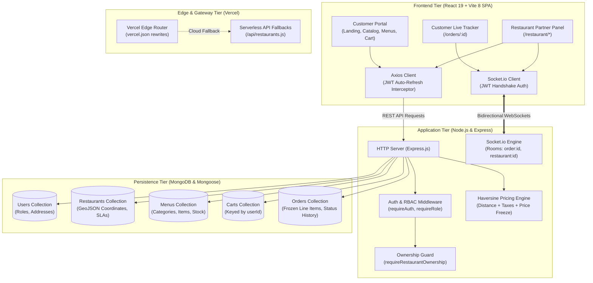
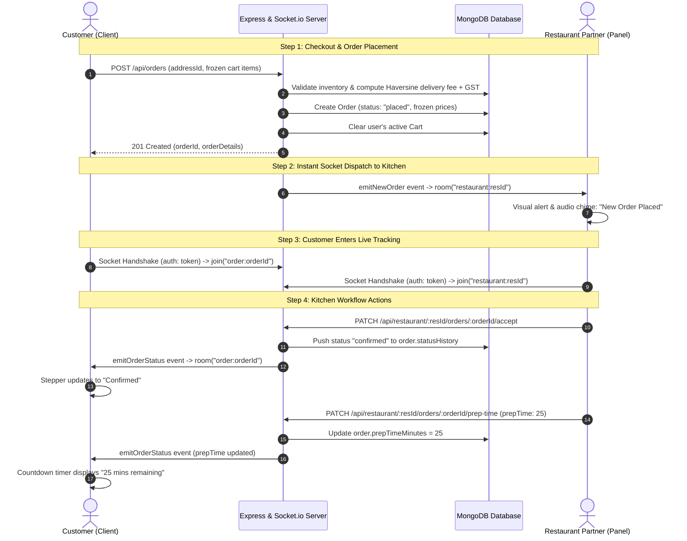
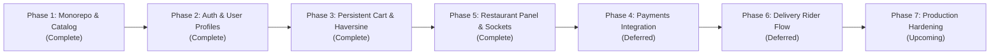

# Swirl: System Architecture & Decision Records (ADR)

> **Document Version:** 2.0.0  
> **Status:** Active / Production MERN Monorepo  
> **Core Stack:** MongoDB, Express, React 19 (Vite 8), Node.js, Socket.io  
> **Deployment Target:** Vercel (Frontend + Edge Fallback) & Node.js / Dockerized Backend

---

## 1. Executive Summary & Architectural Evolution

**Swirl** evolved from a single-page React prototype proxying external delivery aggregator APIs into a self-contained, enterprise-grade **MERN Stack** (MongoDB, Express, React 19, Node.js) platform with real-time bidirectional communication.

The architecture is organized as a high-cohesion, loosely coupled **monorepo** with npm workspaces:
- `client/`: A modern React 19 SPA running on Vite 8, featuring Redux Toolkit for state management, Tailwind CSS v4, dynamic Haversine-based checkout, real-time live order tracking, and a dedicated Restaurant Partner control panel.
- `server/`: An Express.js application backed by MongoDB and Mongoose, providing role-based access control (RBAC), JWT authentication with HTTP-only token rotation, geodesic distance pricing calculations, and authenticated Socket.io room broadcasting.
- `api/`: Cloud serverless function fallbacks ensuring high availability on edge platforms such as Vercel.

This document serves as the **Single Source of Truth (SSOT)** for all Architecture Decision Records (ADRs), system designs, entity schemas, concurrency safety measures, and edge-case mitigations.

---

## 2. High-Level System Architecture



---

## 3. Real-Time Order Lifecycle & Event Dispatch

Swirl leverages Socket.io with scoped room partitioning to deliver real-time bidirectional order notifications. Customer order updates push to the kitchen dashboard instantly, while preparation status changes push back to the customer's live tracking view without manual polling.



---

## 4. Architecture Decision Records (ADRs)

### ADR-001: Monorepo Restructuring with npm Workspaces
- **Status:** Implemented (`482b9c6`)
- **Context:** The project initially combined frontend code and mock proxies in a single root directory. As we introduced an Express server, database models, and seeding scripts, we needed a scalable monorepo structure.
- **Decision:** Restructured the repository into two decoupled packages using native **npm workspaces**:
  - `client/`: React 19 SPA, Vite 8, Redux, Tailwind CSS.
  - `server/`: Express backend, Mongoose models, controllers, services, socket server.
  - Root `package.json`: Orchestrates builds, tests, and development commands.
- **Consequences:** Clear separation of concerns, independent dependency trees, and unified CI build scripting.

---

### ADR-002: Primary Database — MongoDB & Mongoose
- **Status:** Implemented (`482b9c6`)
- **Context:** Food delivery applications handle dynamic nested data structures: hierarchical menu categories with variable option groups, embedded user address books, and point-in-time snapshot cart/order items.
- **Decision:** Selected **MongoDB** with **Mongoose**.
- **Why this over alternatives:**
  - *GeoJSON Spatial Support:* Restaurants and customer addresses store coordinates in GeoJSON format (`type: "Point"`, `coordinates: [lng, lat]`), enabling geospatial indexing (`2dsphere`) and distance queries.
  - *Embedded Document Natural Fit:* Menus contain categories and items that are retrieved together as a document rather than executing 5 relational joins.
  - *Mongoose Schema Rigor:* Provides schema enforcement, pre-save hooks (e.g. bcrypt password hashing), and virtual getters.
- **Consequences:** Transactions must be utilized during multi-document writes (such as order creation and cart clearing).

---

### ADR-003: Authentication & Token Lifecycle — Dual-Token JWT with Silent Rotation
- **Status:** Implemented (`ba6a4cc`)
- **Context:** Needed a secure, stateless authentication mechanism that prevents Cross-Site Scripting (XSS) token theft and handles token expiration gracefully without logging out active users.
- **Decision:** Implemented a **Dual-Token JWT pattern**:
  1. **Access Token:** Short lifespan (15 minutes), passed in the `Authorization: Bearer <token>` header for stateless authorization.
  2. **Refresh Token:** Long lifespan (7 days), stored inside an `httpOnly`, `SameSite=Strict`, `Secure` browser cookie inaccessible to JavaScript.
  3. **Silent Rotation:** The client's custom Axios instance ([`api.js`](file:///Users/ataulhai/Desktop/self/Swirl/client/src/utils/api.js)) intercepts HTTP 401 errors, requests `POST /api/auth/refresh`, updates the in-memory access token, and retries the original request seamlessly.
- **Consequences:** Eliminates storage of sensitive credentials in `localStorage` while guaranteeing non-disruptive sessions.

---

### ADR-004: Cart Persistence & Distance-Based Haversine Pricing Engine
- **Status:** Implemented (`f2518de`)
- **Context:** Storing cart state strictly in client memory causes cart loss on page refresh or device switching. Furthermore, food delivery requires transparent delivery fee calculations and protection against in-flight menu price changes.
- **Decision:**
  1. **Server-Synced Cart Collection:** The MongoDB `Cart` collection is keyed to the user's `userId`. Any cart modification dispatched through Redux triggers an asynchronous sync with the server.
  2. **Add-Time Price Snapshotting:** When an item is added to the cart, its price is snapshotted to prevent unexpected price changes during checkout.
  3. **Restaurant-Switch Safeguard:** Adding an item from a new restaurant immediately prompts or clears the cart from the previous restaurant.
  4. **Haversine Distance Formula:** Checkout dynamically computes geodesic distance between restaurant coordinates and user address coordinates:
     $$\Delta \sigma = 2 \arcsin \left( \sqrt{ \sin^2\left(\frac{\Delta \phi}{2}\right) + \cos(\phi_1) \cos(\phi_2) \sin^2\left(\frac{\Delta \lambda}{2}\right) } \right)$$
     $$\text{Distance (km)} = R \cdot \Delta \sigma \quad (R = 6371\text{ km})$$
     - Base fee: ₹30 for the first 3 km.
     - Additional fee: ₹10/km for distance beyond 3 km.
     - Taxes: 5% GST automatically computed on items subtotal.
- **Consequences:** Orders are created with immutable `frozenPrices`, guaranteeing auditability.

---

### ADR-005: Role-Based Access Control (RBAC) & Multi-Tenant Resource Ownership
- **Status:** Implemented (`6c7120d`)
- **Context:** The system serves multiple user types: customers, restaurant owners, and platform administrators. A restaurant owner must manage only their assigned restaurant and never access another owner's orders or revenue data.
- **Decision:**
  1. **User Role Enum:** `['User', 'RestaurantOwner', 'Admin']` stored directly on the `User` document.
  2. **Role Gate Middleware (`requireRole`):** Verifies that the authenticated user possesses the required role before granting access to `/api/restaurant/*` routes.
  3. **Ownership Validation Middleware (`requireRestaurantOwnership`):** Compares `req.user.restaurantId` with the route parameter `req.params.restaurantId`. If Owner A attempts to query or mutate Owner B's orders, the request is rejected with `HTTP 403 Forbidden`.
- **Consequences:** Guarantees multi-tenant isolation at the controller and route layer.

---

### ADR-006: Bidirectional Event Streaming via Socket.io
- **Status:** Implemented (`6c7120d`)
- **Context:** Traditional HTTP polling creates unnecessary server load and introduces latency for critical updates such as order acceptance and kitchen prep timers.
- **Decision:** Deployed **Socket.io** with scoped room partitioning:
  - **Handshake Authentication:** The WebSocket handshake verifies the customer or owner's JWT access token.
  - **Scoped Rooms:**
    - `restaurant:<restaurantId>`: Only the verified owner of that restaurant joins this room to receive `new_order` dispatches.
    - `order:<orderId>`: The customer placing the order joins this room to receive targeted `order_status` pushes (`confirmed`, `preparing`, `out_for_delivery`).
- **Consequences:** Sub-second latency for order dispatching with zero polling overhead.

---

### ADR-007: Vercel Cloud Deployment & Native Rolldown Bindings
- **Status:** Implemented (`c234eb1`, `b3cade7`)
- **Context:** Deploying a monorepo containing a Vite 8 frontend to Vercel requires consistent cross-platform builds between local developer environments (macOS Apple Silicon) and Linux container build pipelines.
- **Decision:**
  - Configured root `vercel.json` with workspace build delegation:
    `"buildCommand": "npm run build --workspace=client"`, `"outputDirectory": "client/dist"`.
  - Added explicit cross-platform native bindings for Rolldown in `client/package.json` under `optionalDependencies` (`@rolldown/binding-linux-x64-gnu`, `@rolldown/binding-darwin-arm64`, etc.).
  - Added serverless function fallbacks in `api/restaurants.js` and `api/restaurants/[id]/menu.js` so edge deployments seamlessly display restaurant data even in isolated demo configurations.
- **Consequences:** Flawless zero-configuration CI/CD deployments on Vercel without Linux native binding failures.

---

## 5. Data Models & Entity Schemas

### 5.1 User Model (`server/src/models/user.model.js`)
```javascript
{
  name: { type: String, required: true },
  email: { type: String, required: true, unique: true, index: true },
  password: { type: String, required: true, select: false },
  role: { type: String, enum: ['User', 'RestaurantOwner', 'Admin'], default: 'User' },
  restaurantId: { type: Schema.Types.ObjectId, ref: 'Restaurant', default: null },
  addresses: [{
    label: { type: String, default: 'Home' },
    street: String,
    city: String,
    state: String,
    pincode: String,
    location: {
      type: { type: String, enum: ['Point'], default: 'Point' },
      coordinates: [Number] // [longitude, latitude]
    },
    isDefault: { type: Boolean, default: false }
  }]
}
```

### 5.2 Restaurant Model (`server/src/models/restaurant.model.js`)
```javascript
{
  name: { type: String, required: true, index: true },
  cuisines: [{ type: String, index: true }],
  rating: { type: Number, default: 4.0, index: true },
  avgRatingString: String,
  totalRatingsString: String,
  costForTwo: String,
  locality: String,
  areaName: String,
  cloudinaryImageId: String,
  imageUrl: String,
  isOpen: { type: Boolean, default: true },
  location: {
    type: { type: String, enum: ['Point'], default: 'Point' },
    coordinates: { type: [Number], required: true } // 2dsphere index
  },
  sla: {
    deliveryTime: Number,
    slaString: String,
    lastMileTravelString: String
  }
}
```

### 5.3 Cart Model (`server/src/models/cart.model.js`)
```javascript
{
  userId: { type: Schema.Types.ObjectId, ref: 'User', required: true, unique: true },
  restaurantId: { type: Schema.Types.ObjectId, ref: 'Restaurant', default: null },
  items: [{
    itemId: { type: String, required: true },
    name: { type: String, required: true },
    price: { type: Number, required: true }, // Snapshotted price at add-time
    quantity: { type: Number, required: true, min: 1 },
    variant: { type: String, default: null },
    isVeg: { type: Boolean, default: true },
    imageUrl: String
  }]
}
```

### 5.4 Order Model (`server/src/models/order.model.js`)
```javascript
{
  customerId: { type: Schema.Types.ObjectId, ref: 'User', required: true },
  restaurantId: { type: Schema.Types.ObjectId, ref: 'Restaurant', required: true },
  items: [{
    itemId: String,
    name: String,
    price: Number,
    quantity: Number,
    variant: String,
    isVeg: Boolean
  }],
  pricing: {
    itemTotal: Number,
    deliveryFee: Number, // Computed via Haversine
    taxes: Number,       // 5% GST
    totalAmount: Number
  },
  deliveryAddress: {
    street: String,
    city: String,
    pincode: String,
    coordinates: [Number]
  },
  distanceKm: Number,
  prepTimeMinutes: { type: Number, default: 30 },
  currentStatus: {
    type: String,
    enum: ['placed', 'confirmed', 'preparing', 'out_for_delivery', 'delivered', 'cancelled'],
    default: 'placed'
  },
  statusHistory: [{
    status: String,
    timestamp: { type: Date, default: Date.now },
    note: String
  }]
}
```

---

## 6. Real-World Edge Cases & Mitigations

| Edge Case / Scenario | Risk | Technical Mitigation |
| :--- | :--- | :--- |
| **In-Flight Price Surges** | Price changes while customer is browsing; customer is charged more than displayed. | **Frozen Price Snapshots:** Cart snapshots the item price at the moment of addition; order checkout freezes the price upon creation. |
| **Mixed Restaurant Cart** | Customer adds food from Restaurant A, then attempts to add food from Restaurant B. | **Automatic Restaurant Switch Detection:** Cart slice checks `activeRestaurantId`. Switching restaurants requires explicit user confirmation and clears previous items. |
| **Multi-Tenant Data Snooping** | Owner of Restaurant 1 tries to view orders or update prep times of Restaurant 2. | **Strict Ownership Middleware (`requireRestaurantOwnership`):** Validates that `req.user.restaurantId === req.params.restaurantId`. Throws `403 Forbidden` on mismatch. |
| **Token Expiry Mid-Checkout** | JWT access token expires during payment or cart submission. | **Axios Silent Refresh Interceptor:** Automatically catches 401, invokes `/api/auth/refresh`, updates memory, and retries the pending request seamlessly. |
| **Cross-Platform Native CI Failures** | Vite 8 Rolldown native binaries fail on Linux container environments. | **Pre-Resolved Platform Bindings:** Declared in `optionalDependencies` and resolved in root `package-lock.json`. |
| **Transient Database Outage on Edge** | Edge deployment loads without connected database instance. | **Resilient Serverless Fallback Handlers:** `/api/restaurants.js` and `/api/restaurants/[id]/menu.js` serve high-fidelity seed data with search and rating filters. |

---

## 7. Phased Implementation Status & Future Roadmap



### ✅ Completed Milestones
- **Phase 1: Monorepo Restructuring & Catalog API**: Monorepo split (`client/`, `server/`), seed data extraction, Mongoose models, and `GET /api/restaurants` with search, rating, and pagination.
- **Phase 2: Authentication & User Profiles**: User model with embedded addresses, bcrypt hashing, dual JWT token rotation with HTTP-only cookies, and in-app login modal.
- **Phase 3: Persistent Cart & Dynamic Haversine Checkout**: Server-synced cart keyed to `userId`, price freeze protection, Haversine distance pricing, and immutable order creation.
- **Phase 5: Restaurant Partner Panel & Real-Time WebSockets**: Dedicated `/restaurant` dashboard, role-based access control (`requireRole`, `requireRestaurantOwnership`), Socket.io new-order dispatch, kitchen prep-time updates, and customer live order tracker (`/orders/:id`).
- **Landing Page & Production Deployment**: High-converting landing page at `/`, dedicated restaurant catalog at `/restaurants`, and Vercel monorepo configuration with Rolldown native binding support.

### ⏳ Deferred Milestones
- **Phase 4: Payment Gateway Integration**: Webhook handling, payment signature verification, and automated refunds (deferred).
- **Phase 6: Delivery Rider Flow**: Dedicated rider app/routes, turn-by-turn geolocation updates, and rider pickup assignment (deferred).

### 🔮 Phase 7: Production Hardening (Upcoming)
1. **Redis Caching**: Cache-aside layer for restaurant listings and menus with selective invalidation.
2. **Rate Limiting & Security Headers**: Token-bucket rate limiting, `helmet`, and `mongo-sanitize` middleware to prevent NoSQL injection.
3. **Automated CI Security**: `npm audit` and vulnerability scanning integrated into GitHub Actions.
4. **Full Containerization**: Multi-stage `Dockerfile` and `docker-compose.yml` defining client, server, MongoDB, and Redis instances.
